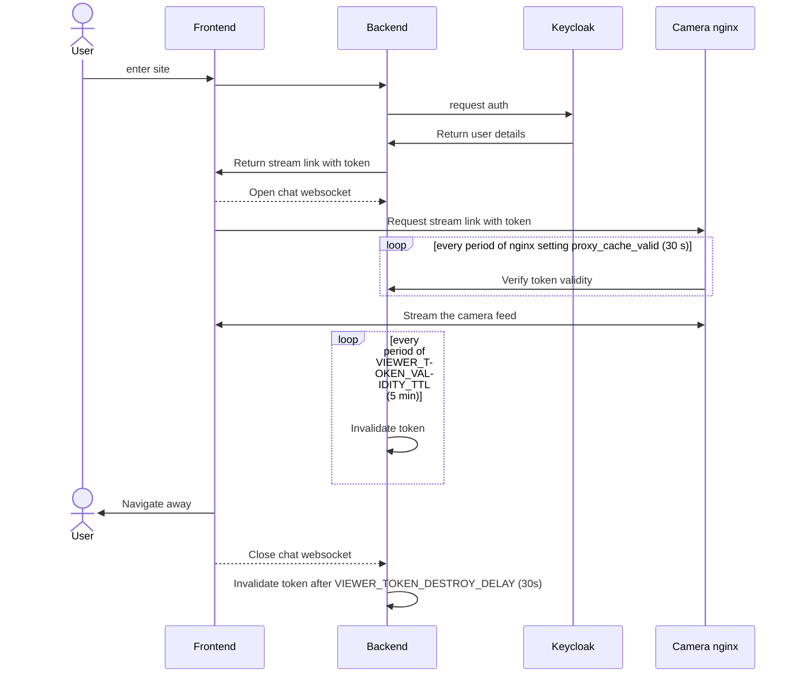

## Camera nginx paths

The camera's nginx (`camera/nginx/nginx.conf`) serves the same HLS files on two paths:

- `/live/hls/<token>/<file>`: kiltiskamera viewers. The token is checked against
  this backend's `/authenticate`.
- `/feed/hls/<token>/<file>`: viewers of the Prodeko portal (same-origin at
  `kiltis.prodeko.org`). The token is checked with
  `GET https://kiltis.prodeko.org/api/kamera/authenticate?token=<token>`
  (`200` allows, `401`/`403` deny). Answers are cached per token for 30 s
  unless the portal sends its own `Cache-Control`.
